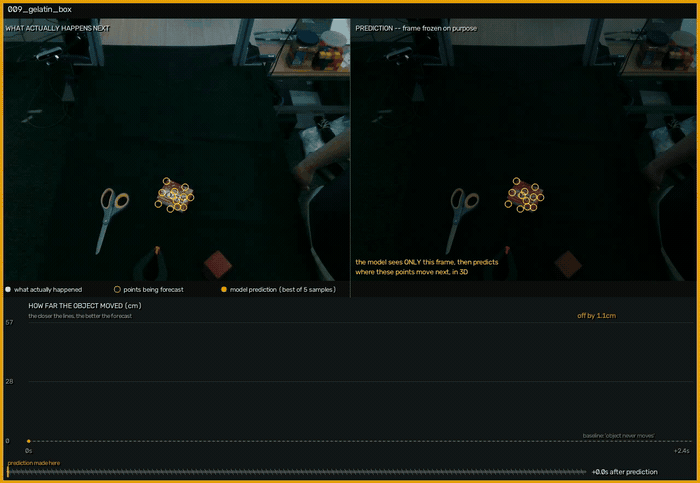
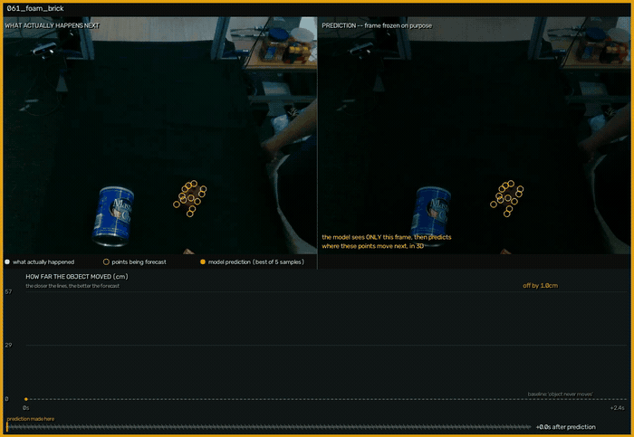
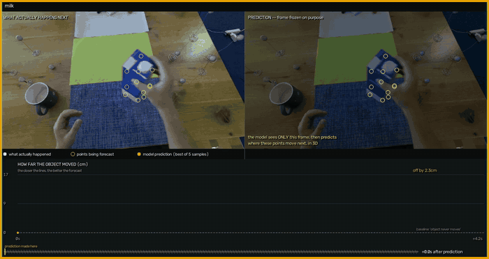

# ForeTrack4D

**Task: Forecast the Future 3D Motion of an Object from a Single RGB Frame using Diffusion Models over Point Tracks.**



*Gelatin box (DexYCB test): moves 46.7 cm, forecast ends 5.8 cm off.*



*Foam brick (DexYCB val): moves 48.5 cm, forecast ends 8.7 cm off.*



*Milk carton, head-mounted moving camera (H2O test): forecast ends 5.2 cm off.*

<sub>Orange: forecast. White: ground truth. Closest of 5 sampled futures.</sub>

## Overview

ForeHand4D forecasts hand motion from a single image and leaves object motion as future work.
ForeTrack4D retargets that recipe to objects and uses TAPIP3D to pseudo-label in-the-wild video
that has no 3D ground truth.

| | |
|---|---|
| **Input** | One RGB frame, 64 query points on the object |
| **Output** | `(128, 64, 3)` world-space tracks in the t=0 camera frame |
| **Model** | MDM-style transformer denoiser, x0 prediction, cosine schedule, depth-scaled L2 |
| **Conditioning** | ViT image features plus one token per query point (Fourier-embedded 3D position and the patch feature at its projection) |
| **Training** | Stage 1: mesh-derived ground truth (DexYCB, ARCTIC, H2O). Stage 2: adds filtered TAPIP3D pseudo-labels (HoloAssist) |
| **Zero-shot eval** | EgoExo4D, never used for training |

## Results

DexYCB held-out test split, n = 1200, cm (lower is better).

| Method | ADE | FDE | M-F | M-G |
|---|---|---|---|---|
| Static (object never moves) | 12.46 | 33.36 | 12.46 | 12.85 |
| Constant velocity* | 12.52 | 33.40 | 12.52 | 12.87 |
| Regressor | **7.85** | **14.50** | **7.55** | **7.63** |
| Diffusion, single sample | 10.45 | 20.19 | 10.41 | 10.33 |
| Diffusion, best of 5† | 7.43 | 15.91 | 7.36 | 7.65 |

\* Uses the true second frame, which the model never sees. † Oracle selection against ground truth.
M-F / M-G are first-frame- and globally-aligned errors, following ForeHand4D.

**Findings**

- **Final-frame error more than halves** against the no-motion baseline: 33.4 cm to 14.5 cm
  (regressor) and 15.9 cm (diffusion, best of 5).
- **The output distribution is calibrated in-domain.** Mean pairwise motion distance is 12.97 cm
  predicted vs 12.15 cm ground truth.
- **Query conditioning is necessary.** Image-only conditioning cannot localize the object
  (`configs/mixed_ablation_no_query_cond.yaml`).

## Limitations

- **Does not generalize out of domain.** On HoloAssist (5.32 vs 8.83 cm) and EgoExo4D zero-shot
  (9.12 vs 12.73 cm), the static baseline beats the model, and predictions collapse to a
  near-constant prior. ForeHand4D's pseudo-label gain does not reproduce for objects at this
  scale (213 accepted clips).
- **Pseudo-label quality is bounded by monocular depth, not label count.** The same tracker
  scores 2.48 cm ADE with sensor depth and 10.53 cm with estimated depth (n = 20,
  `scripts/exp_depth_ablation.py`).
- **Diffusion does not beat a regressor on single-sample accuracy.** Its advantage is the
  calibrated distribution and best-of-5 when a selector exists.
- **Small OOD sets (n = 43, n = 20)**, with machine-generated reference tracks. Treat as
  directional. No published-method baseline exists for this task.

## Setup

```
pip install -e ".[dev]"
scripts/setup_third_party.sh     # clones TAPIP3D and SAM 2
```

Python 3.10, torch 2.4.1 / cu124. Three environments are kept separate: training (this repo),
`tapip3d` (per its README), and labeling (`pip install -e ".[labeling]"`). MANO model files are
required by the dataloaders; place them under `downloads/model/body_models/mano` and set
`DOWNLOADS_DIR`.

## Train and evaluate

```
python scripts/train.py --config configs/mixed_stage1.yaml --model_type diffusion
python scripts/train.py --config configs/mixed_stage2.yaml --model_type diffusion

python scripts/eval.py --config configs/mixed_stage2_diffusion_lowlr_expanded.yaml \
    --diffusion_ckpt <path> --regressor_ckpt <path> \
    --eval_dataset dexycb --split test --horizon_plot horizon.png
```

## License

CC BY-NC 4.0, required by code adapted from ForeHand4D. Per-module provenance is in
[NOTICE.md](NOTICE.md).

## Acknowledgements

Built on [ForeHand4D](https://github.com/ap229997/forehand4d) (Prakash, Forsyth, Gupta),
[TAPIP3D](https://github.com/zbw001/TAPIP3D) (Zhang, Ke, Harley, Fragkiadaki),
[MDM](https://github.com/GuyTevet/motion-diffusion-model) (Tevet et al.), and
[SAM 2](https://github.com/facebookresearch/sam2) (Meta).
